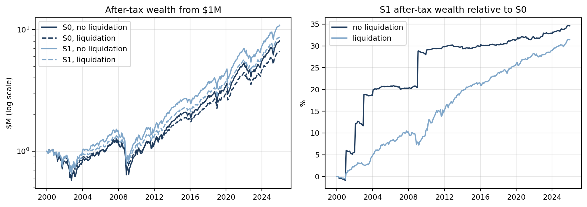
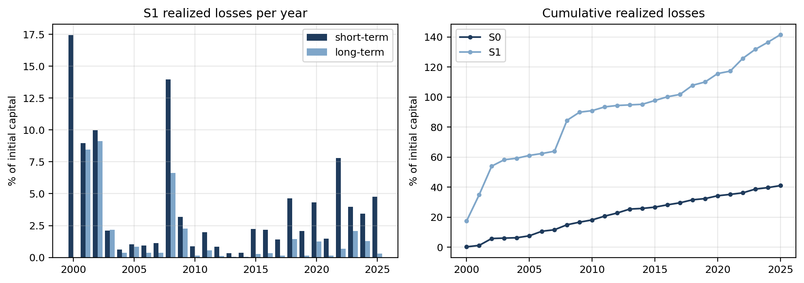
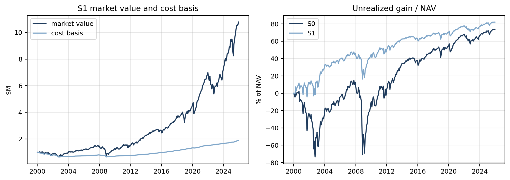
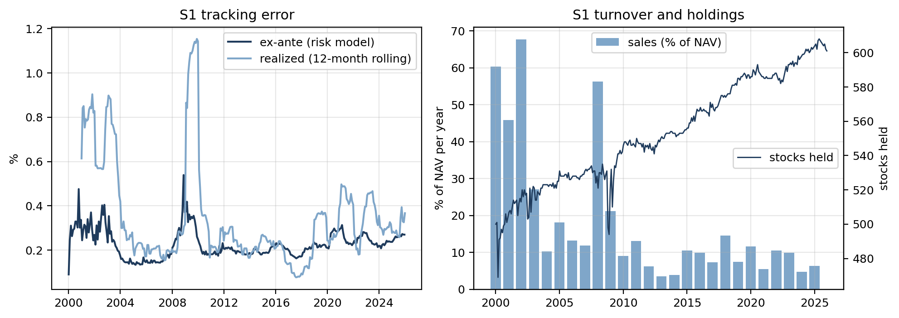
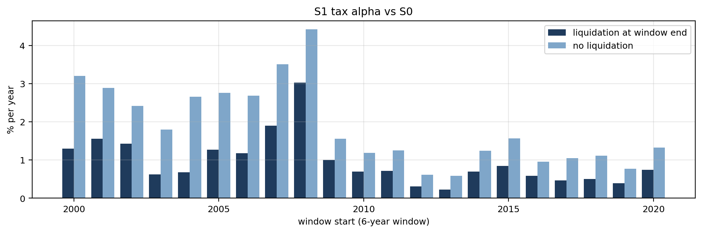
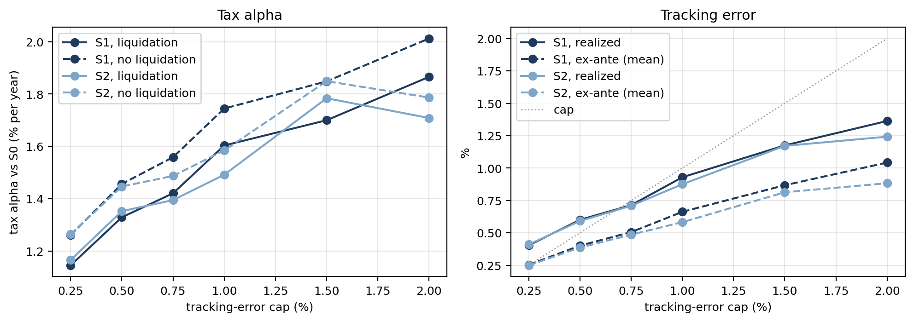

# Tax-Loss Harvesting in a Direct-Indexed S&P 500 Portfolio, 2000–2025

Melody Wang

## Executive Summary

- **Question.** How much after-tax return does tax-aware optimization add to a direct-indexed S&P 500 portfolio on real data? And since harvesting only delays tax rather than avoiding it, does the optimizer do better if it takes the delayed tax into account?
- **Setup.** Survivorship-bias-free CRSP data for the point-in-time S&P 500, January 2000 to December 2025. A $1 million account, rebalanced monthly, tax rates of 40.8% (short-term) and 23.8% (long-term), the wash-sale rule, and 5 bp trading costs.
- **Strategies.** S0 tracks the index and never harvests. S1 is the tax-aware Markowitz optimizer of Moehle et al. (2021) with a risk penalty chosen in-sample to keep tracking error near 0.5%. S2 is S1 with one change: when it harvests a loss, it also counts the extra tax when the account is sold at the end (discounted to today).
- **Results.**
  - *Main:* S1 earns a tax alpha over S0 of **1.14% per year** if the account is sold at the end and **1.25%** if it is not, with a realized tracking error of 0.4% and trading costs of 1.3 bp per year.
  - *Out of sample (2013–2025):* 0.28% / 0.43%. In the calm 2013–2025 bull market S1 deviated less from the index (TE 0.25%) and had few losses to harvest.
  - *Start date:* in 21 six-year windows, tax alpha ranges from 0.22% (2013–2018) to 3.03% (2008–2013). Most losses come in the first years and in sell-offs.
  - *Risk–tax trade-off:* in a separate experiment with a cap on tracking error, raising the cap from 0.25% to 2% raises tax alpha from 1.15% to 1.87%, with diminishing returns.
  - *Optimizer:* the monthly problem is non-convex, so the optimizer solves it approximately in two convex steps. The approximation costs little: in 99% of months, the cost of the trades made is within 0.01% of NAV of the optimal cost.
  - *S2:* no improvement over S1 at the same tracking error.
- **Consistent with published evidence.** The window averages (0.96% sold, 1.88% not sold) are in line with the 1.06% and 1.81% that Goldberg, Cai and Schneider (2024) report for a comparable long-only strategy over 10 years.

## 1. Overview

**Tax-loss harvesting and direct indexing.** A direct index holds the stocks of an index instead of a fund. Each purchase is a tax lot with its own cost basis. When a lot trades below cost, the investor can sell it, realize the loss, and use the loss to offset capital gains elsewhere, while buying other stocks to stay close to the index. This is tax-loss harvesting (TLH). The wash-sale rule disallows the loss if the same stock is bought within 30 days before or after the sale, so a harvested stock cannot simply be bought back.

**Previous work.**

- Moehle, Kochenderfer, Boyd and Ang (2021) write tax-aware portfolio construction as an optimization over risk, trading costs and the tax of each lot sold, and solve it with a two-step convex method. Their backtests test the algorithm; they do not evaluate investment outcomes systematically.
- Empirical studies find a tax alpha of about 1% per year for long-only harvesting, front-loaded and higher in volatile markets (Chaudhuri, Burnham and Lo 2020; Goldberg, Cai and Schneider 2024).

**My contribution.**

- Evaluate the Moehle et al. optimizer on real, survivorship-bias-free S&P 500 data over 26 years, and test a version (S2) that also counts the tax each harvest adds when the account is sold.
- Add a tracking-error cap and trace the trade-off between tracking error and tax alpha.
- Test how robust the result is: an out-of-sample period and 21 staggered six-year windows.

## 2. Data and Method

### 2.1 Data and backtest setup

- **Data.** Daily CRSP data through WRDS. The universe is the point-in-time S&P 500 membership list, including firms later removed, acquired or delisted: 1,107 securities over 2000–2025. Returns from 1999 are used only as risk-model history.
- **Prices and dividends.** Prices come from split-adjusted CRSP returns without dividends; dividends are paid into cash. A delisted stock is sold at its delisting return, or at −30% (Shumway 1997) for the three performance delistings with a missing value.
- **Account.** $1 million in cash on January 3, 2000. Rebalance on the first trading day at least 31 days after the last trade. Keep 0.5% of NAV in cash. One-way trading cost 5 bp.
- **Lots and wash sales.** Lots are sold lowest tax per dollar first (LTFO). Unlike highest cost first out (HIFO), which looks only at cost, LTFO also takes into account that short- and long-term gains are taxed at different rates.
- **Taxes.** Losses offset the investor's other gains in full. The tax of a year is 40.8% of net short-term gains plus 23.8% of net long-term gains, paid in cash at year-end.
- **After-tax return**, two ways:
  - *liquidation*: all positions are sold at the end and the tax on unrealized gains is paid;
  - *no liquidation*: the shares are never sold (step-up at death, or donation).
- **Tax alpha** = after-tax return of a strategy minus that of S0.

### 2.2 S0: direct index without harvesting

- At each rebalance, sell stocks that left the index and trim positions more than 10% above their index weight.
- Invest the remaining cash in the stocks most below their index weight; new index members are bought this way.
- Never sell to realize a loss.

### 2.3 S1: tax-aware Markowitz optimization

At each rebalance S1 chooses purchases $b_i \ge 0$ for each stock and sales $s_l \ge 0$ for each lot $l$ (all as fractions of NAV) to minimize

$$\gamma_{\text{risk}}\,(x+u)^\top V (x+u) \;+\; \kappa \textstyle\sum_i (b_i + s_i) \;+\; \sum_l T_l\, s_l$$

- $x$: active weights against the index; $u = b - s$: net trades; $s_i$: total sales of stock $i$.
- $V$: covariance matrix from the risk model; $\kappa$ = 5 bp.
- $\gamma_{\text{risk}}$ = 400 sets how much tax saving is worth a given deviation from the index. Without the risk term, the optimizer would sell every losing lot and drift far from the index. Since the goal is to track the index, $\gamma_{\text{risk}}$ is chosen in-sample so that tracking error is close to 0.5%, a common budget for direct indexing.
- $T_l = \rho_l\,(1 - \text{basis}_l/\text{price})$: tax per dollar sold of lot $l$, with $\rho_l$ = 40.8% or 23.8%. It is negative for a loss lot.
- **Constraints.**
  - Long only; sales no larger than the lots.
  - No purchases outside the index or blocked by the wash-sale rule.
  - Cash ends at the 0.5% buffer.
  - No stock is bought and sold at once: $b_i s_i = 0$.

**The constraint $b_i s_i = 0$ is non-convex.** It allows only a pure buy or a pure sell, so the allowed trades lie on the two axes of the $(b_i, s_i)$ plane. The point halfway between a pure buy and a pure sell buys and sells at once, so the set is not convex, and a solver can only guarantee the global optimum over a convex set. Two steps handle this.

- **Step 1: convex relaxation.**
  - Drop $b_i s_i = 0$. Without it, the optimizer would sell a loss stock and buy it back at once to collect the tax credit.
  - To prevent this, add a weight $\theta_i \in [0,1]$ (the share of buying) for each stock with a loss lot, with $b_i \le \theta_i b_{\max}$ ($b_{\max}$ = 10% of NAV) and $s_i \le (1-\theta_i)\times$holding.
  - The risk term splits into factor risk and specific risk, because $V = X\Sigma X^\top + D$ (Section 2.4): $(x+u)^\top V (x+u) = (x+u)^\top X\Sigma X^\top (x+u) + \sum_i D_i\,(x_i + b_i - s_i)^2$.
  - For each stock with a loss lot, the specific risk becomes $D_i\,[\,x_i^2 + 2x_i(b_i - s_i) + b_i^2/\theta_i + s_i^2/(1-\theta_i)\,]$.
  - For a pure buy ($\theta_i = 1$, $s_i = 0$) or a pure sell ($\theta_i = 0$, $b_i = 0$), this is the true specific risk. A trade that both buys and sells gets extra risk from the last two terms, so buying and selling at once is discouraged.
  - The extra risk grows with the square of the trade, so the new term is convex and the whole problem is convex; the solver finds $b_i$ and $s_i$.
  - The relaxed problem keeps every trade of the original problem at the same cost and adds mixed trades, so its minimum total cost can only be lower: it is a lower bound on the true minimum.
- **Step 2: fixed directions.**
  - If $b_i - s_i > 0$ in Step 1, set $s_i = 0$ (buy only); otherwise set $b_i = 0$ (sell only).
  - Each stock is now on one axis, so the problem is convex again. Its solution is the trade list that is executed.
- **Gap** = Step 2 objective − Step 1 objective. The true optimum lies between the two, so the gap bounds how far the executed trades are from optimal.

**Parameters chosen in-sample (2000–2012), then held fixed.**

- *Number of factors:* for random portfolios, realized TE / forecast TE is about 0.98 with a correlation of about 0.71 for any $k$ from 5 to 40, so I use a middle value, $k$ = 15.
- *S0 trim band:* 10% gives the lowest tracking error (0.36%, against 0.45% for 25% and 0.61% for no trimming).
- *$\gamma_{\text{risk}}$:* 400, the value among 100, 200 and 400 whose tracking error (0.53%) is closest to 0.5%.

### 2.4 Risk model

- **Why PCA.** The optimizer needs the covariance matrix $V$ of stock returns to measure tracking error. With about 500 stocks and 252 days of data, the sample covariance matrix is too noisy to use. So I assume a few common factors drive all stocks, plus noise specific to each stock: $V = X\Sigma X^\top + D$. I find the factors by principal component analysis (PCA), which needs only returns. Moehle et al. use a commercial Barra model with named factors (industry, size, value…).
- **How it is estimated**, at each rebalance:
  - $R$ ($T \times n$): the trailing 252 days of daily returns, each stock's mean subtracted.
  - SVD: $R = U S W^\top$. The columns of $W$ are the eigenvectors of the sample covariance $R^\top R/(T-1)$, i.e. the principal components, ranked by the variance they explain ($s_j^2$).
  - Keep the top $k$ = 15 (chosen in-sample, Section 2.3): $X$ = the first 15 columns of $W$; factor returns $F = RX$; $\Sigma$ = variance of $F$; $D$ = variance of the residual $R - FX^\top$. All annualized.
- **Stocks with less than half a year of data** (new listings) are not used in the PCA. They are assumed to move like the average stock in their sector, with twice the median specific variance as a conservative guess.

### 2.5 S2: deferral-aware tax term

- Harvesting changes when gains are taxed, not how much is taxed in total. A dollar of loss realized today saves $\rho_{\text{now}}$ now, but adds a dollar of gain taxed at $\rho_{LT}$ when the account is sold at the end.
- S2 discounts that future tax:

$$T_l = (\rho_{\text{now}} - \delta_t\,\rho_{LT})\,(1 - \text{basis}_l/\text{price}), \qquad \delta_t = 1.05^{-(\text{days to the end date})/365}$$

- The term is still linear in the sales, so the two-step method applies unchanged. S2 uses the same $\gamma_{\text{risk}}$ = 400 as S1.

## 3. Results

### 3.1 Main results

- **Tax alpha.** S1 earns 1.14% per year over S0 if the account is sold at the end and 1.25% if it is not. The 0.11% difference is the tax deferred to the end: harvesting lowers the cost basis, so S1 carries larger unrealized gains.
- **Pre-tax vs. tax.** S1's pre-tax return is almost the same as S0's. The optimizer has no return forecasts, so any pre-tax gap comes from S1's deviation from the index, not stock selection; nearly all of the tax alpha comes from taxes (Table 2).
- **Wealth.** By 2025 S1's after-tax wealth is about 31% above S0's with liquidation and 35% without (Figure 1).
- **Cost.** Realized tracking error of 0.43% against 0.30% for S0, and sales of 11% of NAV per year against 1%. Trading costs stay negligible at 1.3 bp per year.
- **Risk.** S1 has the same volatility as S0 and the index (about 15%). Its after-tax maximum drawdown is smaller (−50% vs −54%) because tax refunds are paid into the account during the 2000–2002 and 2008 sell-offs. Tax alpha is about 2.7 times the tracking error.
- **Out of sample (2013–2025)**, tax alpha is 0.28% / 0.43%. The index rose 14.8% per year, so there were few losses to harvest, and with the same $\gamma_{\text{risk}}$ S1 stayed closer to the index (TE 0.25%) than in the more volatile in-sample period.

| % per year | Full S0 | Full S1 | Full S2 | OOS S0 | OOS S1 | OOS S2 |
|---|---|---|---|---|---|---|
| After-tax return, liq. | 7.60 | 8.74 | 8.62 | 12.95 | 13.24 | 13.21 |
| After-tax return, no liq. | 8.41 | 9.67 | 9.50 | 14.58 | 15.01 | 14.91 |
| **Tax alpha, liq.** | – | **1.14** | **1.02** | – | **0.28** | **0.26** |
| **Tax alpha, no liq.** | – | **1.25** | **1.09** | – | **0.43** | **0.34** |
| TE, realized | 0.30 | 0.43 | 0.38 | 0.20 | 0.25 | 0.19 |
| TE, ex-ante (mean) | – | 0.23 | 0.17 | – | 0.17 | 0.11 |
| Tax alpha / TE (liq. / no liq.) | – | 2.66 / 2.92 | 2.68 / 2.87 | – | 1.13 / 1.72 | 1.39 / 1.82 |
| Volatility | 14.97 | 14.96 | 14.94 | 14.06 | 14.04 | 14.04 |
| Max drawdown, after tax | −53.6 | −50.3 | −50.4 | −33.4 | −33.3 | −33.3 |
| Sales turnover (% NAV) | 1.1 | 11.3 | 11.0 | 0.9 | 11.3 | 10.2 |
| Trading cost (bp) | 0.2 | 1.3 | 1.3 | 0.2 | 1.3 | 1.2 |
| ST losses (% initial, total) | 0.9 | 102.0 | 99.2 | 0.2 | 31.2 | 30.3 |
| LT losses (% initial, total) | 40.1 | 39.5 | 40.8 | 7.5 | 11.1 | 10.7 |
| Avg. holdings | 502 | 553 | 564 | 503 | 545 | 541 |

*Table 1. Full period 2000–2025 and out-of-sample (OOS) period 2013–2025, a new $1M account. S1 and S2 use $\gamma_{\text{risk}}$ = 400. The index has a volatility of 15.15% (OOS 14.14%) and a maximum drawdown of −54.7% (OOS −33.5%).*

| % per year | Full period | OOS |
|---|---|---|
| Tax alpha, liq. (S1 − S0, after tax) | 1.14 | 0.28 |
| Pre-tax return gap (S1 − S0) | 0.02 | −0.09 |
| From taxes | 1.12 | 0.37 |

*Table 2. S1's tax alpha split into the pre-tax return gap and the part from taxes. Pre-tax returns: S1 8.34%, S0 8.32%, index 8.22% (OOS 14.63%, 14.72%, 14.75%).*

*Figure 1. Left: after-tax wealth of S0 and S1. Right: S1's after-tax wealth relative to S0. The no-liquidation line jumps at year-ends, when refunds are paid.*

### 3.2 Harvested losses and cost basis

- **Front-loaded.** S1 harvested 17–21% of start-of-year NAV in each of 2000, 2001 and 2002, when almost every lot bought at the start was below cost (Figure 2).
- **Sell-offs.** A second wave came in 2008 (14.5% of start-of-year NAV), smaller ones in 2018, 2020 and 2022.
- **Decay.** Harvesting fades as the account ages. In 2022 the index fell 18%, yet S1 harvested only 1.2% of start-of-year NAV (14.5% in 2008), because after the 2009–2021 rise most lots were still far above cost.
- **S0** realized 41% of initial capital in losses over 26 years, almost all long-term, from index deletions and delistings.
- **Cost basis.** Harvesting replaces high-basis lots with low-basis ones, so S1's basis falls behind its market value (Figure 3). By 2025 unrealized gains are 82% of NAV for S1 and 74% for S0, leaving little to harvest.

*Figure 2. Left: S1's realized short-term and long-term losses per year. Right: cumulative realized losses of S0 and S1.*

*Figure 3. Left: S1's market value and cost basis. Right: unrealized gain as a share of NAV.*

### 3.3 Tracking error, turnover and optimality

- **Tracking error rises in crises.** Tracking error rises in crises because the optimizer harvests more and because the risk model, estimated from the past year, underestimates the new correlations. Realized tracking error averages about twice the forecast (0.43% vs 0.23%) and reaches 1.15% in 2009 (Figure 4).
- **Turnover.** Sales are 46–68% of NAV in 2000–2002 and 56% in 2008, and 4–15% in most later years.
- **Holdings** grow from 500 to about 600 stocks. When a stock leaves the index, S1 keeps it if the tax on selling exceeds the cost of the extra tracking error. These retained stocks accumulate over 26 years.
- **Optimality.** The convex relaxation loses almost nothing. Over 301 rebalances, 99.7% of optimality gaps are below 1 bp of NAV (largest 1.4 bp).

*Figure 4. Left: S1's ex-ante and realized (12-month rolling) tracking error. Right: annual sales and number of stocks held.*

### 3.4 Dependence on the start date

- 21 six-year backtests start each January from 2000 to 2020, each from $1 million, with the same $\gamma_{\text{risk}}$ = 400 (realized tracking error 0.40%).
- S1's tax alpha averages **0.96%** with liquidation and **1.88%** without, but ranges from **3.03%** (2008–13) to **0.22%** (2013–18) (Figure 5).
- Windows that start just before a sell-off (2000, 2007, 2008) harvest the most; those that start in a bull market (2012, 2013, 2019) harvest little.
- The full-period 1.14% is one path that starts just before a bear market, so it is above the window average.

*Figure 5. S1's tax alpha against S0 in six-year windows, by start year.*

### 3.5 Risk–tax trade-off

| Tracking-error cap (%) | 0.25 | 0.5 | 0.75 | 1.0 | 1.5 | 2.0 |
|---|---|---|---|---|---|---|
| Tracking error, ex-ante mean | 0.25 | 0.40 | 0.51 | 0.66 | 0.87 | 1.04 |
| Tracking error, realized | 0.40 | 0.60 | 0.71 | 0.93 | 1.17 | 1.36 |
| Tax alpha, liquidation | 1.15 | 1.33 | 1.42 | 1.60 | 1.70 | 1.87 |
| Tax alpha, no liquidation | 1.26 | 1.46 | 1.56 | 1.74 | 1.85 | 2.01 |
| Sales turnover (% of NAV) | 12.5 | 13.5 | 14.7 | 14.7 | 15.7 | 15.5 |

*Table 3. S1 over 2000–2025 for each tracking-error cap (% per year).*

- This experiment controls risk with a cap on ex-ante tracking error, with $\gamma_{\text{risk}}$ set to a small value, 10 (versus 400), so that the cap sets the risk level. The risk term is then much smaller than the tax savings but similar to trading costs, so it still keeps the portfolio close to the index when trades save about the same tax. The cap is relaxed from 0.25% to 2%.
- **More risk, more tax alpha, at a falling rate.** Going from a 0.25% to a 0.5% cap adds 0.18% of tax alpha; going from 1.5% to 2% adds 0.17% (Figure 6).
- **The cap stops binding above about 1%.** The ex-ante tracking error stays well below the cap, because extra deviation no longer pays for itself in tax savings.
- **Realized tracking error exceeds the cap at low caps** (0.40% at a 0.25% cap), for the reason in Section 3.3.
- S2 is within about 0.2% of S1 at every cap, with no consistent sign.

*Figure 6. Tax alpha (left) and tracking error (right) of S1 and S2 against the tracking-error cap, 2000–2025.*

### 3.6 The deferral-aware tax term

| % per year | S1 (γ = 800) | S2 (γ = 400) | S2 − S1 |
|---|---|---|---|
| Tracking error, realized | 0.31 | 0.28 | −0.03 |
| Tax alpha, liquidation | 0.84 | 0.75 | −0.09 |
| Tax alpha, no liquidation | 1.69 | 1.39 | −0.30 |

*Table 4. S2 against S1 at about the same tracking error, mean over the 21 six-year windows.*

- **Full period:** with the same $\gamma_{\text{risk}}$, S2 earns 1.02% / 1.09% against S1's 1.14% / 1.25%, but with less tracking error (0.38% vs 0.43%). Under the same tracking-error cap (Section 3.5) the two are within about 0.2%.
- **Six-year windows:** S2 values each harvest less, so it is compared with an S1 that has a higher $\gamma_{\text{risk}}$ and about the same tracking error. S2 earns less in all 21 windows, by 0.09% with liquidation and 0.30% without (Table 4).
- **Why it does not help.** S2 skips some harvests, especially of long-term losses, to avoid extra tax at the end. But each harvest frees up tax that can be reinvested in stocks, which is more than enough to pay that extra tax. So S2 reinvests less and ends with less wealth than S1.

## 4. Conclusions

- **Tax-aware optimization works on real data.** Over 2000–2025, S1 earns about 1.1–1.3% per year over a non-harvesting direct index with a tracking error of about 0.4% and negligible trading costs.
- **The value depends on the path.** Losses come early and in sell-offs. A portfolio started before a sell-off earns over ten times the tax alpha of one started in a steady bull market, and harvesting fades as unrealized gains build up.
- **Consistent with published evidence.** Over six-year windows S1 averages 1.88% (no liquidation) and 0.96% (liquidation). Goldberg, Cai and Schneider (2024) report 1.81% and 1.06% for a comparable long-only strategy over 10 years. As in their study, most losses come in the first decade: our account had realized net losses of 75% of its starting value by year 10 and they barely grew after.
- **More tracking error buys more tax alpha**, at a falling rate. The ex-ante risk model understates tracking error in crises, when most harvesting happens.
- **The deferral-aware term is not needed.** The standard tax term already does as well, because reinvested refunds earn more than the discount rate.
- **Who benefits most:** investors with high tax rates, short-term gains elsewhere to offset, and no plan to sell the shares.

**Limitations.**

- First, losses offset the investor's other gains in full. If those gains run out, only $3,000 a year can offset ordinary income and the rest is carried forward (IRC §§1211(b), 1212(b)), so harvesting would be worth less.
- Second, today's tax rates are used for all 26 years, and trading costs are a fixed 5 bp with no price impact.
- Third, the risk model underestimates tracking error in crises.
- Fourth, CRSP treats spin-offs as price adjustments, so a spun-off company must be bought separately.
- Finally, the sample starts in 2000, just before a bear market, which raises the full-period result; the six-year windows only partly address this, because they overlap and cover one history.

**Next steps.**

- Model the investor's tax situation: the $3,000 limit and carryforwards in the backtest and in the optimizer's tax term, which stays convex.
- A 130/30 long–short version, which Goldberg, Cai and Schneider (2024) show keeps producing losses after a long-only account stops.
- Contributions and withdrawals, donation of low-basis lots, and historical tax rates.

## References

Chaudhuri, S. E., Burnham, T. C., and Lo, A. W. (2020). An empirical evaluation of tax-loss-harvesting alpha. *Financial Analysts Journal*, 76(3), 99–108.

Goldberg, L. R., Cai, T., and Schneider, B. (2024). A guide to 130/30 loss harvesting. *Journal of Asset Management*, 25(5), 445–459.

Moehle, N., Kochenderfer, M. J., Boyd, S., and Ang, A. (2021). Tax-aware portfolio construction via convex optimization. *Journal of Optimization Theory and Applications*, 189, 364–383.

Shumway, T. (1997). The delisting bias in CRSP data. *Journal of Finance*, 52(1), 327–340.

Internal Revenue Code §§1211(b), 1212(b).
